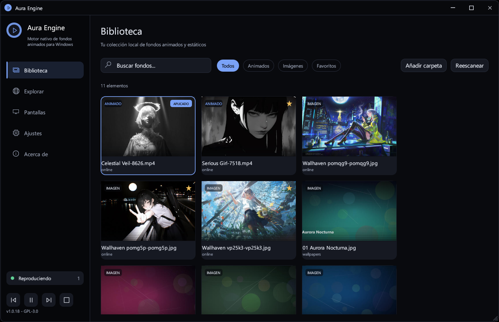
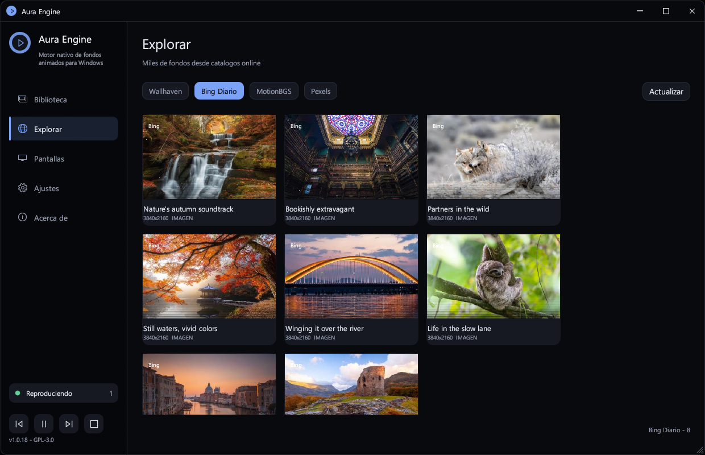
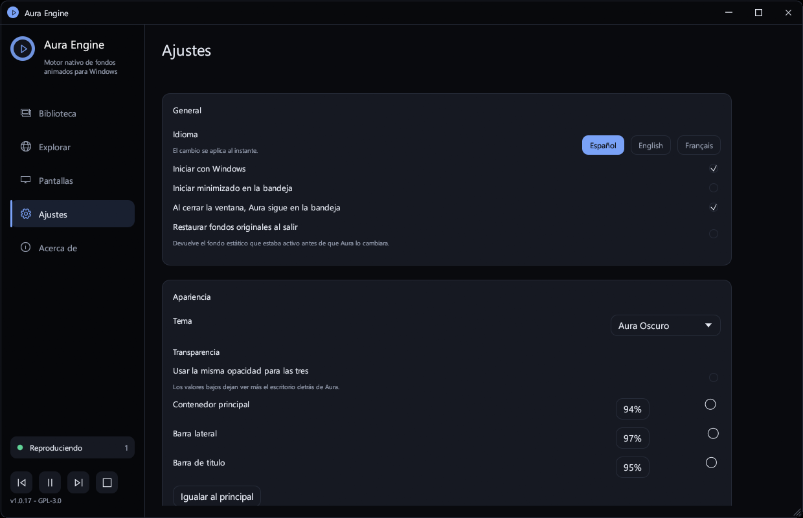

# Aura Engine para Windows

Port nativo a **Windows 10/11 (x64)** de [Aura](https://github.com/antwny/aura), el motor de fondos de pantalla animados escrito en Rust para COSMIC Desktop.

Aura Engine pinta vídeos y fondos estáticos **detrás de los iconos del escritorio**, con multi-monitor real, pausa automática en juegos a pantalla completa, bandeja del sistema, atajos globales y un selector rápido (HUD) con tres estilos.

```
UI (egui)  ──►  WorkerW (capa del escritorio)  ──►  mpv --wid  ──►  vídeo
    │                    ▲
    └── named pipe ──────┘  IPC de mpv + configuración JSON
```

---

## Características

- **Vídeo animado detrás de los iconos** mediante la técnica `WorkerW`/`Progman` de Windows. Sin ventanas encima del escritorio.
- **Multi-monitor**: una instancia de mpv por pantalla, con posición, DPI y resolución independientes. Reconexión automática al conectar/desconectar pantallas o al reiniciar Explorer. Las asignaciones se guardan con la **identidad PnP del panel**, no con el nombre `\\.\DISPLAYn`, así que sobreviven a las renumeraciones de Windows (actualizar el driver de la GPU, cambiar de puerto o reconectar la pantalla).
- **Fondos estáticos nativos** con `IDesktopWallpaper`, incluido restaurado del fondo original.
- **Auto-pausa inteligente**:
  - juegos/apps D3D a pantalla completa (`SHQueryUserNotificationState` + enumeración de ventanas): **solo se pausa la pantalla ocupada**, las demás siguen animándose,
  - escritorio cubierto por ventanas (oclusión real enumerando ventanas): **solo la pantalla tapada**,
  - batería (`GetSystemPowerStatus`, global).
- **Audio**: volumen y mute por IPC de mpv.
- **Selector rápido (HUD)** con tres estilos: cuadrícula, cinematográfico y dock. Navegación con teclado, rueda y ratón.
- **Bandeja del sistema** con menú completo.
- **Actualizaciones automáticas** desde GitHub Releases, con verificación SHA-256 e instalación desde la propia app.
- **Temas personalizables** en Ajustes → Apariencia: Aura Oscuro, Medianoche, Claro y Personalizado, con color de acento.
- **Ventana translúcida** con barra de título propia y opacidad independiente para el contenedor, la barra lateral y la barra de título, con modo vinculado.
- **Esquinas redondeadas** y cierre completo desde la bandeja (con watchdog si el apagado se bloquea).
- **Atajos globales** (Ctrl+Alt+…).
- **Biblioteca local** con miniaturas (mpv extrae el primer fotograma), búsqueda, filtros y favoritos. Las tarjetas de **Biblioteca** indican con badges `1`, `2`… en qué pantalla **conectada** está aplicado cada fondo, incluyendo el caso de una misma imagen en varias pantallas; la numeración es siempre consecutiva (`1..=N`) sobre las pantallas detectadas y nunca muestra números de pantallas desconectadas.
- **Arranque sin parpadeo**: la ventana se crea invisible, se pinta con la paleta de la app en ambos temas de egui (y en el marco nativo de DWM) y se limpia con el fondo opaco hasta un frame después de mostrarse. Windows tampoco puede pintar su marco estándar al activar la ventana (Alt+Tab, minimizar/restaurar o volver desde la bandeja), evitando el destello blanco incluso con Windows en modo claro.
- **Catálogos online**: Wallhaven, Bing Daily, **MotionBGS** (live wallpapers 4K/1080p) y Pexels (clave opcional).
- **Tema dinámico**: extrae el color dominante del fondo y adapta la interfaz; opcionalmente tiñe el acento de Windows (best-effort).
- **Interfaz en español, inglés y francés**, seleccionable al instante en Ajustes → General.
- **CLI completa** e **instancia única** mediante named pipe.
- **Auto-descarga de mpv** portable desde GitHub si no está instalado.
- **Rendimiento**: arranque/parada de mpv en segundo plano, detección de oclusión en un hilo aparte, filtros de biblioteca cacheados, miniaturas descargadas en paralelo y repintado adaptativo (la UI nunca se bloquea).

---

## Capturas de pantalla

### Biblioteca


### Explorar


### Ajustes


---

## Descargas

Cada release publica tres artefactos:

- `aura-vX-windows-x64-setup.exe` — **instalador recomendado**: menú Inicio, acceso directo opcional, inicio con Windows opcional, entrada en Aplicaciones instaladas y desinstalador.
- `aura-vX-windows-x64.exe` — ejecutable portable.
- `aura-vX-windows-x64.zip` — paquete portable con `install.ps1`/`uninstall.ps1`, documentación y certificado público.

https://github.com/Amaru221/AuraEngine/releases

Los paquetes oficiales **no incluyen mpv**: Aura lo descarga en el primer uso desde el build oficial de mpv. Así la distribución oficial contiene únicamente el código GPL de Aura (más documentación y certificado). El `.exe` portable funciona igual.

---

## Instalación

### Opción A — Instalador (recomendada)

Ejecuta `aura-vX-windows-x64-setup.exe`. El asistente permite:

- Instalar solo para el usuario actual (sin UAC) o para todos los usuarios.
- Crear un acceso directo en el escritorio (marcado por defecto).
- Iniciar Aura con Windows (marcado por defecto).
- Confiar en el certificado autofirmado de este build (opcional).
- Elegir el idioma (español/inglés).

El instalador crea el grupo **Aura Engine** en el menú Inicio (busca "Aura Engine"), registra la app en **Configuración → Aplicaciones → Aplicaciones instaladas** y añade un desinstalador que puede borrar también la configuración, la caché y los fondos descargados.

Instalación silenciosa:

```powershell
.\aura-v1.1.2-windows-x64-setup.exe /VERYSILENT /SUPPRESSMSGBOXES /NORESTART
```

### Opción B — Portable

```powershell
cd .\dist\aura-v1.1.2-windows-x64
.\aura.exe
```

Funciona sin instalar: `mpv.exe` se detecta junto al ejecutable. La configuración se guarda en `%APPDATA%\Aura`.

### Opción C — Script de PowerShell (sin instalador)

El ZIP incluye el instalador clásico para despliegues desatendidos:

```powershell
powershell -ExecutionPolicy Bypass -File .\install.ps1 -TrustCertificate
```

Instala en `%LOCALAPPDATA%\Aura\bin` y crea un acceso directo en el menú Inicio.

Opciones: `-NoStart`, `-NoShortcut`, `-DownloadMpv`.

### Opción D — Compilar desde el código

Requisitos: **Rust stable (MSVC)** y **Visual Studio Build Tools** con el SDK de Windows.

```powershell
git clone https://github.com/Amaru221/AuraEngine.git AuraEngine
cd AuraEngine
cargo build --release
.\target\release\aura.exe
```

### Opción E — Generar instalador y ZIP

```powershell
.\scripts\build.ps1 -Sign            # ZIP portable
.\scripts\build-installer.ps1 -Sign  # instalador Inno Setup
```

Genera `dist\aura-v1.1.2-windows-x64.zip` y `dist\aura-v1.1.2-windows-x64-setup.exe`.
El instalador necesita [Inno Setup 6](https://jrsoftware.org/isinfo.php)
(`winget install --id JRSoftware.InnoSetup -e`).

---

## Uso

### Idioma

Cambia el idioma en **Ajustes → General → Idioma**: español, inglés o francés. La interfaz, la bandeja del sistema y los textos de estado se actualizan al instante y la elección se guarda en `config.json`.

### Bandeja del sistema

Clic izquierdo: abrir Aura. Clic derecho: abrir, siguiente/anterior, pausar, selector rápido, detener y salir.

Al cerrar la ventana, Aura sigue en la bandeja (configurable).

### Administrador de tareas

- **Finalizar tarea** cierra Aura por completo (no la deja en la bandeja).
- **Cambiar a** trae de vuelta la ventana si estaba oculta.
- El botón **X** de la ventana sigue ocultándola en la bandeja (configurable en Ajustes).

### Desinstalar

**Configuración → Aplicaciones → Aplicaciones instaladas → Aura Engine → Desinstalar**.
El desinstalador cierra la app y pregunta si quieres borrar también `%APPDATA%\Aura` y
`%LOCALAPPDATA%\Aura` (configuración, caché, miniaturas y fondos descargados).

### CLI

```text
aura [comando]
aura <archivo> [--monitor \\.\DISPLAY1]

next                 Siguiente fondo de la biblioteca
prev                 Fondo anterior
apply <archivo>      Aplica un vídeo o imagen
pause | resume       Pausa / reanuda
toggle-pause         Alterna la pausa
stop                 Detiene y restaura el fondo original
switcher             Abre/cierra el selector rápido
show                 Muestra la ventana
settings             Abre Ajustes
library | explore | monitors | about   Abre esa sección
rescan               Reescanear la biblioteca
status               Estado actual
doctor               Diagnóstico (pantallas, mpv, capa WorkerW)
install-mpv          Descarga mpv portable
set-wallpaper  [índice]   Fondo estático (prueba/diagnóstico)
motionbgs <categoria>          Abre Explorar en una categoría de MotionBGS
search-motionbgs <texto> [--category id]    Busca en MotionBGS
download-motionbgs <texto> [--category id]  Descarga el primer resultado
                              ids: all, anime, games, 4k, superhero, nature
quit                 Cierra Aura
```

Si Aura no está en ejecución, los comandos que lo necesitan arrancan una instancia oculta en la bandeja.

### Atajos globales

| Acción | Atajo |
| --- | --- |
| Selector rápido | `Ctrl + Alt + W` (abrir/cerrar) |
| Siguiente | `Ctrl + Alt + →` |
| Anterior | `Ctrl + Alt + ←` |
| Pausa / reanudar | `Ctrl + Alt + Espacio` |
| Detener | `Ctrl + Alt + S` |

Los atajos globales se desactivan automaticamente mientras hay un juego o app a pantalla completa en primer plano y se reactivan al salir.
Dentro del HUD: flechas/WASD mover, `RePág`/`AvPág` paginar, `Enter` aplicar, `Espacio` pausa, `F` favorito, `Esc` cerrar. `Ctrl+Alt+W` vuelve a abrir/cerrar el HUD.

---

## Catálogos online

| Fuente | Contenido | Clave |
| --- | --- | --- |
| **MotionBGS** | Live wallpapers 4K y 1080p + categorías Anime, Games, 4K, Superhero y Nature | No |
| **Wallhaven** | Fondos estáticos UHD | Opcional (SFW sin clave) |
| **Bing Daily** | 8 fondos UHD del día | No |
| **Pexels** | Vídeos y fotos | Sí (gratuita) |

MotionBGS se obtiene mediante scraping de sus tarjetas HTML (igual que el Aura original) y la descarga usa los endpoints `/dl/4k/{id}/` y `/dl/hd/{id}/`.

Dentro de **Explorar → MotionBGS** hay chips de categoría:

- **Todos** (`motionbgs.com/`)
- **Anime** (`/tag:anime/`)
- **Games** (`/tag:games/`)
- **4K** (`/4k/`)
- **Superhero** (`/tag:superhero/`)
- **Nature** (`/tag:nature/`)

La búsqueda por texto es global; al escribir una búsqueda se vuelve a la categoría *Todos*.

---

## Cómo funciona

1. **Ventana anfitriona**: por cada monitor con vídeo se crea una ventana hija sin bordes y click-through.
2. **Capa del escritorio**: se envía `0x052C` a `Progman` para que Explorer cree la capa `WorkerW`; la ventana se reparenta a esa capa (en Windows 11 24H2+ suele ser un `WorkerW` hijo de `Progman`).
3. **mpv embebido**: se lanza `mpv.exe --wid=<HWND>` con `--loop-file=inf`, `--no-config` y `--input-ipc-server=\\.\pipe\aura-…`.
4. **IPC**: comandos JSON por named pipe. La conexión y el escritor corren en hilos aparte, así que la UI nunca espera a mpv.
5. **Pausa**: un hilo independiente consulta fullscreen, oclusión y batería en una sola enumeración de ventanas; la UI solo aplica el último estado. Fullscreen y oclusión se aplican **por pantalla**: cada instancia de mpv solo se detiene si una app a pantalla completa o una ventana grande cubre su monitor, y las ventanas que quedan detrás de ese fullscreen no cuentan como oclusión. La batería sigue siendo global.
6. **Estáticos**: se aplican con `IDesktopWallpaper::SetWallpaper` una sola vez. El monitor se localiza por la identidad PnP del panel (las rutas de `IDesktopWallpaper` no comparten el orden de `EnumDisplayMonitors` y pueden incluir pantallas fantasma). No se recrean hosts ni se reaplican, evitando el bucle con `WorkerW`.

### Por qué no se reutilizó `mpvpaper`

`mpvpaper` depende de `wlr-layer-shell` (Wayland) y de sockets Unix. En Windows el equivalente es `mpv --wid` sobre `WorkerW`, que es exactamente lo que implementa este port.

---

## Configuración

| Ruta | Contenido |
| --- | --- |
| `%APPDATA%\Aura\config.json` | Configuración y asignaciones por monitor |
| `%LOCALAPPDATA%\Aura\bin\mpv.exe` | mpv portable descargado |
| `%LOCALAPPDATA%\Aura\cache\thumbs` | Miniaturas |
| `%LOCALAPPDATA%\Aura\cache\online` | Resultados de MotionBGS en caché (20 min) |
| `%LOCALAPPDATA%\Aura\wallpapers\online` | Descargas de los catálogos |
| `%LOCALAPPDATA%\Aura\logs` | `aura.log` y logs de mpv |

La configuración se guarda de forma atómica y se recupera automáticamente si se corrompe.

---

## Solución de problemas

**El fondo aparece por encima de los iconos**
Ajustes → Rendimiento → *Modo de composición* → **Progman**. Vuelve a aplicar el fondo.

**No se reproducen vídeos**
Ajustes → Motor: comprueba que mpv está detectado. Usa *Descargar mpv* o indica un `mpv.exe`. Revisa `%LOCALAPPDATA%\Aura\logs\mpv-*.log`.

**El fondo se pausa constantemente**
Desactiva *Pausar pantallas tapadas* o *Pausar en juegos a pantalla completa* en Ajustes → Rendimiento. La pausa automática es por pantalla: solo se detiene el fondo de la pantalla cubierta (por una app a pantalla completa o por una ventana maximizada); el resto sigue reproduciéndose.

**MotionBGS bloquea la búsqueda**
MotionBGS está detrás de Cloudflare y puede bloquear una IP completa. Si la web tampoco abre en el navegador, Aura mostrará un aviso específico: necesitas una VPN o un proxy con otra IP. No se reintenta automáticamente para no empeorar el bloqueo. Los resultados ya cargados se guardan en caché durante 20 minutos; **Actualizar** y **Reintentar** sí consultan el sitio de nuevo.

**La UI va lenta**
Aura evita el trabajo pesado por frame: la versión de mpv se consulta una sola vez, las miniaturas usan claves cacheadas y un límite de memoria, el filtro de la biblioteca solo se recalcula cuando cambia la búsqueda y **Explorar** descarga sus catálogos la primera vez que entras (no al arrancar). Si persiste, revisa el consumo con:

```powershell
$p = Get-Process aura | Select-Object -First 1
$c = $p.CPU
Start-Sleep 6
$p.Refresh()
"CPU en 6 s: $([math]::Round($p.CPU - $c, 2))"
```

**Windows Defender / SmartScreen**
El ejecutable está firmado con un certificado autofirmado. Usa `install.ps1 -TrustCertificate` o compila desde el código.

**Tras actualizar el driver de la GPU aparecen números de pantalla de más o se pierden los fondos**
Windows renumera los dispositivos (`\\.\DISPLAY1` → `\\.\DISPLAY6`) al actualizar el driver. Aura guarda la identidad del panel y revincula la asignación a la pantalla correcta al arrancar y en cada cambio de topología; las entradas de pantallas que ya no existen se ignoran en la Biblioteca y en Pantallas. La interfaz numera siempre las pantallas conectadas como `1..=N` (primaria primero), así que nunca verás un `6` o un `7` suelto porque Windows haya renumerado los dispositivos. Si la configuración era anterior a este cambio, vuelve a aplicar el fondo una vez: a partir de ahí la asignación seguirá al monitor. `aura doctor` muestra la identidad de cada pantalla y cuántas rutas ve `IDesktopWallpaper` (puede conservar monitores fantasma del driver anterior).

---

## Desarrollo

```powershell
cargo check
cargo test
cargo build --release
```

Estructura:

```text
src/
  main.rs            arranque, CLI vs GUI, instancia única
  app.rs             estado, orquestación, IPC, auto-pausa
  cli.rs             interfaz de línea de comandos
  config.rs          configuración serde + rutas
  engine/
    mpv.rs           proceso mpv, IPC por named pipe, extracción de frames
    installer.rs     descarga/extracción de mpv portable
    mod.rs           motor multi-monitor
  platform/
    host.rs          ventanas WorkerW, reparentado, diagnóstico
    ipc.rs           servidor/cliente named pipe
    static_wallpaper.rs  IDesktopWallpaper
    win.rs           monitores, DPI, energía, fullscreen/oclusión, registro
  scanner/           escaneo de biblioteca y miniaturas
  online/
    mod.rs           Wallhaven, Bing, Pexels
    motionbgs.rs     scraping del catálogo MotionBGS
  theme.rs           paleta, fuentes Segoe UI/MDL2, estilos egui
  ui/                biblioteca, explorar, pantallas, ajustes, about, HUD
```

Tests unitarios cubren configuración, escalado, paleta, hash, rutas, extensiones y el parser de MotionBGS.

---

## Firma de código

El ejecutable incluido está firmado con un certificado **autofirmado** (`CN=Aura Engine (Self-Signed)`), SHA-256 y sello de tiempo de DigiCert.

```powershell
Get-AuthenticodeSignature .\aura.exe
# Status: Valid (si el certificado está en el almacén de confianza del usuario)
```

### Confiar en el certificado (solo para pruebas)

```powershell
.\install.ps1 -TrustCertificate
```

O manualmente:

```powershell
certutil -addstore -f -user Root .\certs\aura-selfsigned.cer
certutil -addstore -f -user TrustedPublisher .\certs\aura-selfsigned.cer
```

> **Importante:** una firma autofirmada **no elimina SmartScreen** en otros equipos. Solo es válida donde se importe el `.cer`. Para distribución pública necesitas un certificado emitido por una CA.

### Firma real para distribución

Desde 2023 las CA exigen que la clave privada resida en un token/HSM o servicio cloud:

| Opción | Coste | Notas |
| --- | --- | --- |
| **Azure Trusted Signing** | ~9,99 USD/mes | Validación de identidad; integración con GitHub Actions |
| **SignPath.io** | Gratis para OSS | Firma en CI para proyectos open source |
| **Certum / Sectigo / DigiCert** | 200–600 USD/año | OV/EV, token físico o HSM cloud |

```powershell
.\scripts\sign.ps1 -Path .\target\release\aura.exe -Thumbprint <THUMBPRINT>

# o con PFX (CI):
.\scripts\sign.ps1 -Path .\target\release\aura.exe -Pfx .\cert.pfx -PfxPassword $env:PFX_PASSWORD
```

### Quitar el certificado autofirmado

```powershell
Get-ChildItem Cert:\CurrentUser\My,Cert:\CurrentUser\Root,Cert:\CurrentUser\TrustedPublisher |
    Where-Object { $_.Subject -like "*Aura Engine (Self-Signed)*" } |
    Remove-Item
```

---

## Diferencias con Aura (Linux)

| Aura (Linux) | Aura Engine (Windows) |
| --- | --- |
| `libcosmic` (Wayland) | `egui`/`eframe` |
| `mpvpaper` + `wlr-layer-shell` | `WorkerW` + `mpv --wid` |
| Sockets Unix | Named pipes |
| `cosmic-randr` / `wlr-randr` | `EnumDisplayMonitors` |
| D-Bus GameMode / UPower | `SHQueryUserNotificationState` / `GetSystemPowerStatus` |
| `ksni` (StatusNotifier) | `tray-icon` |
| GSettings / COSMIC theme | `IDesktopWallpaper` + acento de Windows (opt-in) |
| Actualizador `.tar.gz` | ZIP + instalador PowerShell |

---

## Licencia

**GPL-3.0-or-later**. Ver [LICENSE](LICENSE), [NOTICE](NOTICE), [THIRD_PARTY_LICENSES.txt](THIRD_PARTY_LICENSES.txt) (textos completos) y [THIRD_PARTY_LICENSES.md](THIRD_PARTY_LICENSES.md).

Código fuente de la release: `https://github.com/Amaru221/AuraEngine/tree/vX` (sustituye `vX` por la etiqueta de la versión).

Aura original: [antwny/aura](https://github.com/antwny/aura) (GPL-3.0-or-later). Aura Engine es un **port no oficial**, sin afiliación ni respaldo del proyecto original. Se distribuye **sin garantía**.

mpv **no se incluye** en los assets oficiales. Si Aura lo descarga en el primer uso, mpv sigue bajo su propia licencia (GPL-2.0-or-later, algunas partes LGPL-2.1-or-later); su código fuente está en [mpv-player/mpv](https://github.com/mpv-player/mpv) y los builds en [shinchiro/mpv-winbuild-cmake](https://github.com/shinchiro/mpv-winbuild-cmake).
